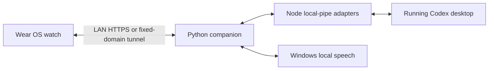

# chatgpt-watch

English · [中文](README.md)


Continue your computer's Codex chats from a Wear OS watch: read synchronized messages, dictate a prompt, change the next message's model, stop a response, and answer supported approval requests.

This is an independent community project, unaffiliated with OpenAI, ChatGPT, Codex, or watch manufacturers. The public watch application is named **WatchChat**. The repository name describes its intended use.

## Features

- **Shared conversations:** the desktop is the source of chat history. Watch messages continue the same desktop conversation instead of creating a separate inference runtime.
- **History and projects:** search, pin, rename, archive/restore, open on desktop, and keep separate drafts for each computer and chat.
- **Input and reading:** keyboard input, review-before-send speech recognition, text-to-speech, copy/quote actions, and older-message pagination.
- **Response controls:** interrupt the current response and allow, reject, or answer supported desktop requests from the watch.
- **Models and usage:** a compact model/reasoning selector below the composer; display the usage limits and reset times reported by the desktop account. Normal account charges and limits still apply.
- **Round-screen UI:** continuous crown scrolling, interactive swipe-back, boundary feedback, optional haptics, font and background preferences.
- **Connection modes:** discover a computer on the LAN, or optionally use your own fixed domain through a Cloudflare named tunnel.

Source version: **0.13.0 (19)**. Public application ID: `org.watchchat.app`. It is separate from private builds using another application ID; their signing keys, saved connections, and drafts are not migrated. The watch UI is currently primarily Chinese. Both Chinese and English documentation are included; full English UI localization is not implemented.

## Requirements and compatibility

| Component | Requirement |
| --- | --- |
| Watch | Wear OS or a compatible Android watch capable of installing APKs, Android 11 / API 30+, and network access. Manufacturer restrictions may apply. |
| Computer | Windows 10/11, a running and signed-in Codex desktop application, Python 3.11+, Node.js 20+. The model catalog also requires the `codex` command on PATH. |
| Build tools | JDK 17 or 21, Android SDK Platform 35 and Platform Tools. The Gradle Wrapper is included. |
| LAN | Devices must be mutually reachable; allow the companion's TCP 8766 and mDNS UDP 5353 on your trusted local network. |
| Internet mode, optional | Your own domain with Cloudflare-managed DNS and a configured `cloudflared` named tunnel. |

**The computer, Codex desktop, and companion must remain running.** Locking the desktop is supported; sleep, shutdown, desktop exit, or lost connectivity prevents use. Startup is manual in this version. No system service or login startup entry is installed.

Desktop integration uses the application's local App Tools pipe and client coordination protocol. **These are not stable public APIs.** The adapter was derived from desktop version `26.1027.6604.0`; other versions can be incompatible. History, interruption, and approval support depend on the interfaces actually exposed by the installed desktop. A successful build does not establish compatibility with every Codex version.

## Installation

### 1. Clone and prepare the companion

Run in PowerShell. Prefer a short, local path rather than a network drive.

```powershell
git clone https://github.com/cyuni1996/chatgpt-watch.git
cd chatgpt-watch
python -m pip install -r bridge/requirements.txt
node --version
codex --version
```

If you use a Python virtual environment, activate it before installation and before starting the companion. Node transport scripts use built-in modules; there is no npm installation step.

### 2. Configure a real caller chat

The first launch needs an **existing local Codex chat ID** as the desktop tool caller context. Do not invent an ID or publish yours.

- When an agent starts `tools/start-companion.ps1` from a Codex chat whose environment supplies `CODEX_THREAD_ID`, the launcher saves it automatically.
- For a manual launch, replace `YOUR_EXISTING_CHAT_UUID` below with a real local chat ID. How to obtain it depends on the desktop version; the agent in that chat may be able to read its own session context.

```powershell
python tools/computer_runtime.py --caller-thread-id YOUR_EXISTING_CHAT_UUID --name "My PC"
```

The value is stored only in ignored `.local/computers/<machine-key>/`. It provides a caller context; the selected watch chat continues to use its own conversation ID.

### 3. Build and install the watch APK

Install Android Studio/SDK and set `ANDROID_HOME`, or create a private `local.properties` with `sdk.dir`. Never commit that file.

```powershell
$env:JAVA_HOME = "C:\path\to\jdk"
$env:ANDROID_HOME = "C:\path\to\Android\Sdk"
.\gradlew.bat :app:assembleDebug
```

The debug APK is `app/build/outputs/apk/debug/app-debug.apk`. Enable developer options and wireless debugging on the watch, then use its current pairing and debugging addresses:

Dependencies use Google and Maven Central by default. If those hosts are unreachable from your network, append `-PuseRepositoryMirror=true` to explicitly opt into the Aliyun mirrors, including Robolectric downloads. TLS validation remains enabled.

```powershell
adb pair WATCH_IP:PAIRING_PORT
adb connect WATCH_IP:DEBUG_PORT
adb install -r app/build/outputs/apk/debug/app-debug.apk
```

Enter the watch's current pairing code when prompted. Pairing and debugging ports are usually different. ADB is needed for installation/updates, not daily app communication. Debug signing uses a key generated locally by your Android tooling. To update in place, preserve both the application ID and signing key. Uninstalling erases the watch's local settings and drafts.

For distribution, run `.\gradlew.bat :app:assembleRelease`. The release APK is **unsigned** by default. Sign it using your own private key through Android Studio's Generate Signed App Bundle / APK workflow or `apksigner`. No signing key or ready-to-install official release is included. See [Android's build and signing instructions](https://developer.android.com/build/building-cmdline).

### 4. Start and pair over LAN

1. Open and sign in to Codex desktop; keep the caller chat from step 2 available.
2. Double-click `Start Companion.cmd`, or run the startup command below. The companion remains in the background after the launcher window closes.
3. Run `python tools/manage_connections.py pair`, or double-click `开启电脑配对.cmd`, to open a three-minute pairing window.
4. On the watch, open **设置 → 电脑连接 → 局域网扫描** (Settings → Computer connection → LAN scan).
5. Select the computer and compare the code on both devices. Enter `y` on the computer only if they match.
6. Reuse the saved computer afterward. If its LAN address changes, scan it again to update the address without replacing its chat state.

```powershell
powershell.exe -NoProfile -ExecutionPolicy Bypass -File tools/start-companion.ps1
# Stop this companion without closing Codex desktop
powershell.exe -NoProfile -ExecutionPolicy Bypass -File tools/stop-companion.ps1
```

LAN transport uses HTTPS with certificate pinning, on TCP 8766 by default. Restrict access to your trusted LAN; do not forward this port directly to the Internet.

## Navigation

| Control | Action |
| --- | --- |
| Top-left menu, tap only | Chat history. Horizontal swipes do not open it. |
| Center title | Details for the current chat, including project/computer information and chat management. |
| Top-right gear | Application settings. |
| Thin row below the composer | Select model and reasoning effort. Saving affects the next send; Back cancels unsaved choices. |
| Send button during a response | Becomes the Stop button. |
| Swipe down on the chat header | Account usage. Vertical gestures inside messages still scroll the chat. |
| Horizontal swipe / Back | Return one level while preserving drafts and page position. |
| Crown / double-tap messages / long-press a message | Scroll / jump to latest / message actions. |

Pending requests open automatically and can be reopened from chat details. Requests already handled on the desktop are not executed again. Physical button support varies by device; system power/home buttons are not intercepted. Polling, recording, and speech stop when the app leaves the foreground. This does not interrupt work already submitted to the computer.

## Optional public connection

See [English installation details](docs/INSTALL.en.md#public-connection) or [中文安装说明](docs/INSTALL.zh-CN.md#公网连接). No deployed domain, tunnel, or tunnel credentials are provided by this repository.

## Development



```text
app/        Native Kotlin/Android watch UI and tests
bridge/     Python HTTPS companion, Windows speech, Node desktop adapters and tests
tools/      Start/stop, pairing, tunnel configuration, isolated fixtures and public-tree checks
docs/       Bilingual setup, privacy, artwork and maintenance notes
gradle/     Wrapper and version catalog
```

```powershell
python -m unittest discover -s bridge -p "test_*.py"
python -m unittest discover -s tools -p "test_*.py"
node --test bridge/control_state.test.mjs bridge/control_transport.test.mjs
.\gradlew.bat :app:testDebugUnitTest :app:lint :app:assembleDebug :app:assembleRelease
python tools/check_public_tree.py --tracked
```

These regressions use synthetic data and isolated services. They do not send prompts to real chats. Hardware automation requires a separately authorized ADB connection and a debuggable APK; it is not run by the commands above.

## Troubleshooting and limitations

- **No LAN computer:** check the companion, network isolation, firewall and mDNS. Discovery runs briefly while its page is in the foreground.
- **Paired, but no history:** check Codex desktop, the real caller chat ID, and protocol compatibility. Local logs are under `.local/computers/`; redact them before sharing.
- **No models:** check that `codex` is on PATH and signed in. The model catalog uses a read-only app-server request without starting an inference chat.
- **Speech fails:** allow the watch microphone and install the required Windows recognition/TTS language components. Speech uses Windows `System.Speech`, not a separately configured paid speech API.
- **Public mode fails:** check DNS and both running processes: tunnel and companion. Web-login interception is not supported by the current watch client.
- Attachment upload, full code-diff review, external web authentication, workspace management, and complex forms still require a computer.
- Existing account permissions and approval policies remain effective. A watch approval answers the original request rather than changing global policy.

## Privacy and license

Runtime identities, tokens, private keys, chat caches, real screenshots, recordings, and personal device details are excluded. They are generated locally when the app is used. **An ignore rule cannot remove secrets already committed.** Run the public-tree check and review staged files before publishing. See [Security and privacy](SECURITY.md).

Source code is [MIT licensed](LICENSE). The maintainer has confirmed permission to redistribute the included dragon-character runtime artwork; see [artwork terms](docs/ASSETS.md). The code's MIT license does not automatically apply to that artwork. Dependencies and trademarks retain their own terms; see [third-party notices](THIRD_PARTY_NOTICES.md).

Detailed installation: [English](docs/INSTALL.en.md) · [中文](docs/INSTALL.zh-CN.md).
