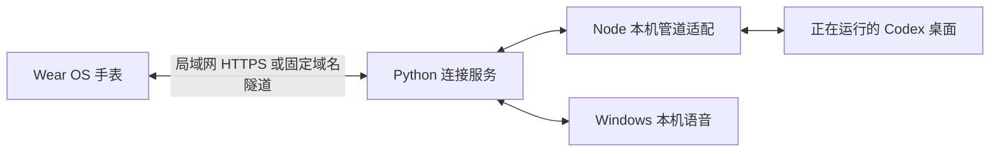

# chatgpt-watch

[English](README.en.md) · 中文


在 Wear OS 手表上继续电脑里的 Codex 聊天：查看同步消息、语音输入、切换模型，并在手表上处理停止回复与操作确认。

这是社区项目，与 OpenAI、ChatGPT、Codex 或手表厂商没有官方隶属关系。仓库名用于说明用途；手表上的公开版应用名为 **WatchChat**。

## 看效果，交给 AI 安装

https://github.com/user-attachments/assets/c6b781af-372e-4de7-a3f0-96b153650c7e

[观看完整实机视频](https://github.com/cyuni1996/chatgpt-watch/releases/download/v0.13.0/watch-demo.mp4) · [离线演示与复制安装提示](docs/demo.html) · [下载签名 APK](https://github.com/cyuni1996/chatgpt-watch/releases/tag/v0.13.0)

视频使用真实手表录屏，聊天、模型和额度均为虚构演示数据，不展示真实私人聊天。

把这句话发给电脑上有终端权限的 AI，即可按 [AI 安装指南](AI_INSTALL.md)开始：

> 请帮我安装 https://github.com/cyuni1996/chatgpt-watch 。先读 AI_INSTALL.md，优先使用 Release 签名 APK 并校验 SHA-256。保留已有应用与草稿，用读取历史验证连接；需要我操作手表时再提示我。

新用户不必先安装 JDK 或 Android Studio。统一入口为 `python tools/setup_watch.py`，支持环境检查、下载校验、安装、启动、配对和只读验证。首次解锁、无线调试授权与两端核对码仍需用户操作。

## 能做什么

- **同一段聊天，两端继续**：读取电脑原有聊天；手表发送的内容进入同一会话，不另建一套聊天历史。
- **聊天管理**：按项目查看历史、搜索、置顶、重命名、归档／恢复、在电脑打开。草稿按电脑和聊天分别保存。
- **输入与阅读**：键盘输入、录音后核对识别文字、朗读回复、长按复制／引用、加载较早消息。
- **控制正在进行的回复**：停止本轮回复，在手表上允许／拒绝支持的操作确认、回答选择或文本问题。
- **模型与额度**：底部快捷切换模型及思考强度，查看电脑账号返回的额度与重置时间。账号费用与额度按原服务规则计算。
- **圆屏交互**：表冠连续滚动、跟手横滑返回、边界反馈、可关闭触感、字号与背景设置。
- **两种连接**：同一局域网内扫描配对；可选自有固定域名加 Cloudflare 命名隧道。

当前源码版本为 **0.13.0（19）**。公开版标识为 `org.watchchat.app`，不覆盖其他标识的私人版本；连接、草稿和签名也不会自动迁移。当前手表界面主要为中文；这里提供中文和英文文档，尚未实现完整的英文界面。

## 先了解运行条件

| 部分 | 要求 |
| --- | --- |
| 手表 | 可安装 Android APK 的 Wear OS／兼容设备，Android 11 / API 30 及以上；有网络连接。实际兼容性取决于厂商系统。|
| 电脑 | Windows 10 / 11，已打开并登录 Codex 桌面应用，Python 3.11+、Node.js 20+；模型目录还需要可运行的 `codex` 命令。|
| 安装 | 预编译签名 APK 与 Android Platform Tools（ADB）；不需要 JDK／Android Studio。|
| 源码构建（可选） | JDK 17 或 21、Android SDK Platform 35、Platform Tools；Gradle Wrapper 已包含。|
| 局域网 | 电脑与手表能互访，防火墙允许连接服务 TCP 8766 和 mDNS UDP 5353。|
| 公网（可选） | 自有域名、Cloudflare 管理的 DNS、`cloudflared` 命名隧道。|

**电脑、Codex 桌面和连接服务均需运行。** 锁屏后可继续使用；休眠、关机、退出桌面应用或断网后不可用。当前方式是手动运行连接脚本；没有安装系统服务或自动启动项。

本项目使用桌面应用自带的本机 App Tools 管道及客户端协调协议，**不是稳定公共 API**。协议参考实现来自桌面版本 `26.1027.6604.0`，其他版本可能不兼容。桌面历史／停止／确认等能力取决于已安装版本实际提供的接口。不要将“能编译”理解为“兼容任意 Codex 桌面版本”。

## 安装与首次连接

### 1. 获取源码并安装电脑依赖

在 PowerShell 中执行。建议将工程放在本机普通目录，避免中文路径、网络盘或过长路径对构建工具的影响。

```powershell
git clone https://github.com/cyuni1996/chatgpt-watch.git
cd chatgpt-watch
python -m pip install -r bridge/requirements.txt
node --version
codex --version
```

如果使用 Python 虚拟环境，请先激活，再运行后续脚本，确保依赖与启动使用同一个解释器。Node 传输层只使用内置模块，无需 `npm install`。

### 2. 绑定电脑上的调用会话

首次启动需要一个**真实、属于当前电脑的 Codex 聊天 ID**，用作桌面工具的调用上下文。不能填随机编号，也不要公开这个编号。

- 在 Codex 聊天内让代理从该工程运行 `tools/start-companion.ps1` 时，若环境提供 `CODEX_THREAD_ID`，启动器会自动保存它。
- 手动启动时，先把已存在的聊天编号填入下方命令（用实际编号替换 `YOUR_EXISTING_CHAT_UUID`）。聊天编号的获取方式取决于桌面版本，可由正在使用的 Codex 聊天读取自身会话上下文。

```powershell
python tools/computer_runtime.py --caller-thread-id YOUR_EXISTING_CHAT_UUID --name "My PC"
```

配置保存在忽略的 `.local/computers/<本机标识>/`，不进入 APK 或 Git。这个编号只提供调用上下文；手表选中的聊天仍按其自己的会话编号读写。

### 3. 构建并安装手表应用

安装 Android Studio／Android SDK，并设置 `ANDROID_HOME`，或在本机 `local.properties` 中设置 `sdk.dir`。该文件必须保持不提交。

```powershell
$env:JAVA_HOME = "C:\path\to\jdk"
$env:ANDROID_HOME = "C:\path\to\Android\Sdk"
.\gradlew.bat :app:assembleDebug
```

输出为 `app/build/outputs/apk/debug/app-debug.apk`。在手表开启开发者选项和无线调试，使用其显示的实际端口：

默认依赖来自 Google 与 Maven Central；若所在网络无法访问，可在 Gradle 命令末尾加 `-PuseRepositoryMirror=true`，明确启用阿里云仓库镜像（包括 Robolectric 下载）。无需降低 TLS 校验。

```powershell
adb pair WATCH_IP:PAIRING_PORT
adb connect WATCH_IP:DEBUG_PORT
adb install -r app/build/outputs/apk/debug/app-debug.apk
```

配对端口与调试端口通常不同；在提示时输入手表当次配对码。ADB 仅用于安装／更新，日常连接不依赖它。调试包由本机自动生成的调试密钥签名。以后覆盖更新必须保持应用标识与签名一致；不要随意卸载，否则会丢失手表本地连接与草稿。

发布构建执行 `.\gradlew.bat :app:assembleRelease`，默认输出**未签名** APK；请通过 Android Studio 的 Generate Signed App Bundle / APK 或 `apksigner` 使用自己的私有密钥签名。仓库不含签名密钥；已签名预编译包单独发布在 [GitHub Release](https://github.com/cyuni1996/chatgpt-watch/releases/tag/v0.13.0)。见 [Android 官方构建与签名说明](https://developer.android.com/build/building-cmdline)。

### 4. 启动、扫描与配对

1. 电脑打开 Codex，并保持第 2 步所用聊天可用。
2. 双击 `Start Companion.cmd`，或执行下方启动命令。启动后服务在后台运行，关闭启动窗口不等于停止服务。
3. 双击 `开启电脑配对.cmd`，或运行 `python tools/manage_connections.py pair`，打开 3 分钟配对窗口。
4. 手表进入 **设置 → 电脑连接 → 局域网扫描**，选择电脑。
5. 核对手表与电脑显示的码完全一致，在电脑输入 `y` 允许。
6. 已保存的电脑以后直接点击连接；电脑换局域网地址时，重新扫描同一电脑以更新地址。

```powershell
powershell.exe -NoProfile -ExecutionPolicy Bypass -File tools/start-companion.ps1
# 停止本工程的连接服务，保留 Codex 桌面
powershell.exe -NoProfile -ExecutionPolicy Bypass -File tools/stop-companion.ps1
```

局域网入口为带证书指纹固定的 HTTPS，默认 TCP 8766。仅向可信局域网放行；不用把这个端口直接映射到互联网。

## 手表入口与操作

| 位置／动作 | 功能 |
| --- | --- |
| 左上角菜单（点击） | 历史聊天；横滑不会打开菜单。|
| 中间标题 | 当前对话详情：完整标题、项目、电脑状态及聊天管理。|
| 右上角齿轮 | 应用设置。|
| 输入框下方细栏 | 模型与思考强度；保存后影响下次发送，返回取消未保存选择。|
| 正在回复时的发送按钮 | 变为停止按钮。|
| 聊天顶栏向下滑 | 账号额度；正文纵向滑动仍滚动消息。|
| 横滑／返回键 | 逐级返回；保留草稿与上一页位置。|
| 表冠／双击正文／长按消息 | 滚动／回到最新／消息操作。|

确认请求自动展示；关闭后可从对话详情重新打开。桌面先处理的请求不会再次执行。物理按键能力取决于设备，应用不接管系统电源键或主键。前台轮询，息屏或退后台停止网络轮询、录音与朗读；这不等于停止已经提交到电脑的任务。

## 公网连接（可选）

详见 [中文公网安装说明](docs/INSTALL.zh-CN.md#公网连接) 或 [English installation guide](docs/INSTALL.en.md#public-connection)。此仓库没有附带已部署域名或隧道凭据，也没有代你开放公网。

## 项目结构与开发



```text
app/        原生 Kotlin / Android 手表界面与测试
bridge/     Python HTTPS 服务、Windows 语音、Node 桌面管道适配与回归
tools/      启停、配对、隧道配置、隔离夹具与公开内容检查
docs/       中英文安装、安全、素材与维护说明
gradle/     Gradle Wrapper 与版本目录
```

```powershell
python -m unittest discover -s bridge -p "test_*.py"
python -m unittest discover -s tools -p "test_*.py"
node --test bridge/control_state.test.mjs bridge/control_transport.test.mjs
.\gradlew.bat :app:testDebugUnitTest :app:lint :app:assembleDebug :app:assembleRelease
python tools/check_public_tree.py --tracked
```

测试使用虚构数据和隔离服务，不需要向真实聊天发送消息。设备自动化脚本另需授权的 ADB 连接和可调试包，默认不在上述回归中运行。

## 局限与故障排查

- 找不到电脑：检查电脑服务、同网段、访客网络隔离、防火墙及 mDNS；扫描仅在前台短时进行。
- 能配对但读不到历史：检查 Codex 是否打开、调用聊天编号是否真实有效，以及桌面协议是否兼容；日志在对应 `.local/computers/` 下。分享日志前先脱敏。
- 模型列表失败：确认 `codex` 在 PATH 且已登录；模型目录通过只读 app-server 读取，不创建推理会话。
- 语音失败：检查手表麦克风权限与 Windows 语音识别／朗读语言包；使用 Windows `System.Speech`，不额外配置收费语音 API。
- 公网失败：检查域名 DNS、隧道与连接服务是否同时运行；需要网页登录的访问拦截不适合当前手表客户端。
- 图片、附件上传、完整代码差异审阅、外部网页登录、工作区管理和复杂表单仍需电脑处理。
- 当前账号权限与审批策略继续适用。手表端确认只是原请求的远程入口，不修改全局权限。

## 隐私、安全与许可证

本仓库排除了运行身份、口令、证书私钥、聊天缓存、真实截图、录音和个人设备资料。运行后会在本机重新生成这些私有数据；**`.gitignore` 不会自动清除已提交的秘密**。提交前运行检查并人工审阅暂存内容。详见 [安全与隐私 / Security](SECURITY.md)。

代码采用 [MIT](LICENSE)。龙娘运行素材由维护者确认获准再分发，授权范围单独说明于 [素材说明](docs/ASSETS.md)，不自动套用代码的 MIT 许可。第三方依赖和商标权利仍归原权利人，见 [第三方说明](THIRD_PARTY_NOTICES.md)。

详细安装文档：[中文](docs/INSTALL.zh-CN.md) · [English](docs/INSTALL.en.md)。
