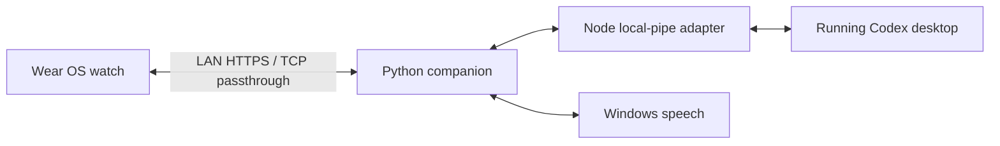

# 开发指南 / Development

[中文首页](../README.md) · [English overview](../README.en.md) · [贡献说明](../CONTRIBUTING.md)

## 结构 / Structure

```text
app/        Native Kotlin / Android UI and tests
bridge/     Python HTTPS companion, Windows speech and Node desktop adapters
tools/      Setup, pairing, isolated fixtures and checks
docs/       Installation, offline showcase and artwork notes
gradle/     Wrapper and version catalog
```



桌面适配使用本机 App Tools 与客户端协调协议，参考实现来自 Codex 桌面 `26.1027.6604.0`。这些接口随版本变化，不属于稳定公共 API。适配器不启动第二个推理会话。

The adapter uses version-dependent local App Tools/client coordination protocols derived from desktop `26.1027.6604.0`. These are not stable public APIs. It does not start a second inference chat.

## 构建与回归 / Build and regression

Android 构建环境见[中文安装文档](INSTALL.zh-CN.md#源码构建)或 [English instructions](INSTALL.en.md#source-build)。

```powershell
python -m pip install -r bridge/requirements.txt
python -m unittest discover -s bridge -p "test_*.py"
python -m unittest discover -s tools -p "test_*.py"
node --test bridge/control_state.test.mjs bridge/control_transport.test.mjs
.\gradlew.bat :app:testDebugUnitTest :app:lint :app:assembleDebug :app:assembleRelease
```

回归使用虚构数据和隔离服务；设备自动化另需授权的 ADB 设备。真实聊天与审批不得用于自动化测试。

Regressions use synthetic fixtures. Hardware automation separately requires authorized ADB access. Do not exercise live chats or approvals during automated tests.

发布时，Git 标签使用 `v<versionName>`，从该标签构建并签名，将 APK 命名为 `chatgpt-watch-<versionName>.apk`。在同一个 Release 中提供 `SHA256SUMS`，按 `<sha256>  <filename>` 格式写入该 APK 的校验值。发布前运行 `apksigner verify`。

Build and sign from the `v<versionName>` tag, name the APK `chatgpt-watch-<versionName>.apk`, and attach it with `SHA256SUMS` to the same Release. Use `<sha256>  <filename>` for the checksum entry and run `apksigner verify` before publishing.

## 提交前检查 / Before publishing

```powershell
git add .
python tools/check_public_tree.py --tracked
python tools/check_public_tree.py --history
git diff --cached --check
git diff --cached
```

检查器只报告文件、规则和行号，不输出疑似秘密。可通过 `--deny-file` 提供仓库之外的私有标识清单。扫描不能代替人工审阅媒体和历史；已泄漏的秘密还需撤销或轮换。`.gitignore` 无法清除旧提交。

The checker reports paths/rules/lines without echoing suspect values. `--deny-file` accepts an external private identifier list. Review media/history manually too; revoke leaked credentials. Ignore rules do not erase old commits.

运行身份、口令、证书、聊天缓存、日志和签名密钥均不应提交。Git 提交署名使用你选择的公开名称和隐私邮箱。美术素材贡献另需来源与许可，见[素材说明](ASSETS.md)。

Keep runtime credentials, certificates, chat caches, logs and signing keys out of Git. Choose an intentional public commit identity. Artwork contributions need provenance and permission; see the asset terms.
